# NAS Player

An Android TV / Google TV app for watching video, listening to music and viewing photos straight from a NAS over SMB (Windows / Samba / TrueNAS / Synology shares) or WebDAV. It also reads USB drives. It has no cloud, no accounts, no media scanning and no metadata scraping: you browse folders and press play, and everything plays inside the app.

<p align="center">
  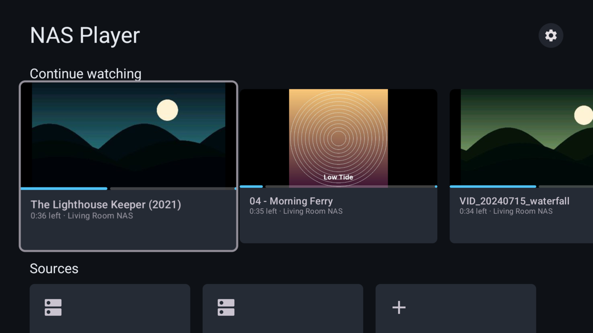
</p>

| | |
|---|---|
| 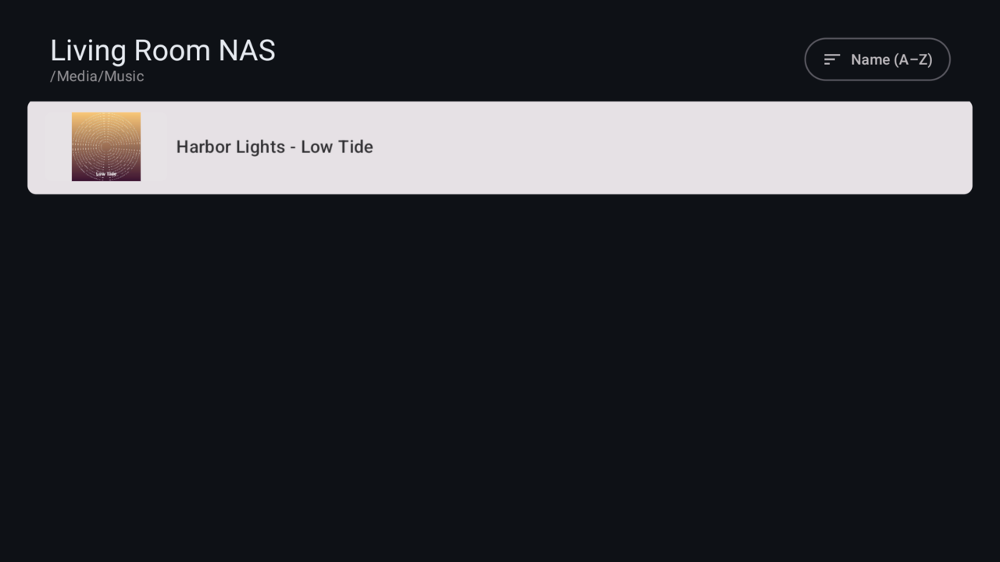 | 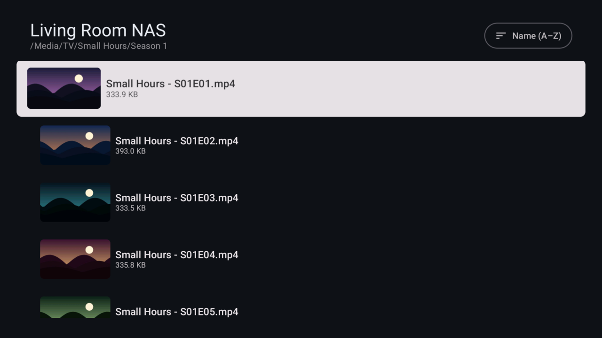 |
| Movie folders use their `poster.jpg` | Episodes get a frame from the video |
| 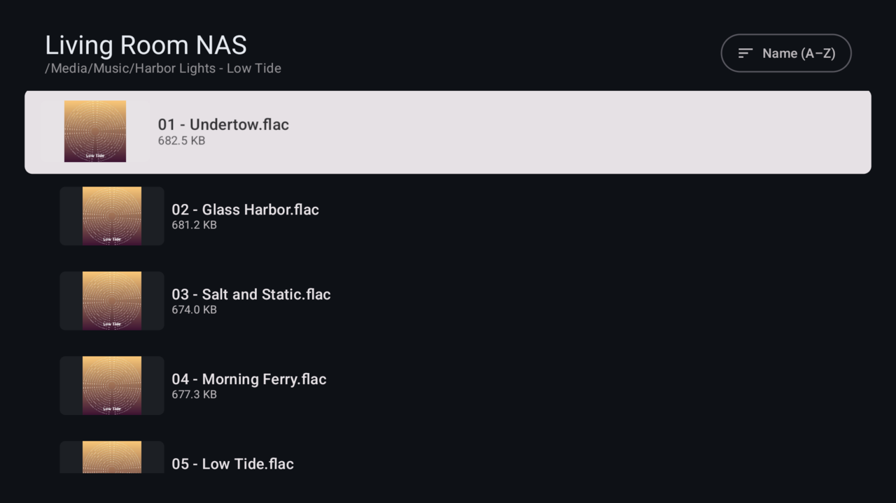 | 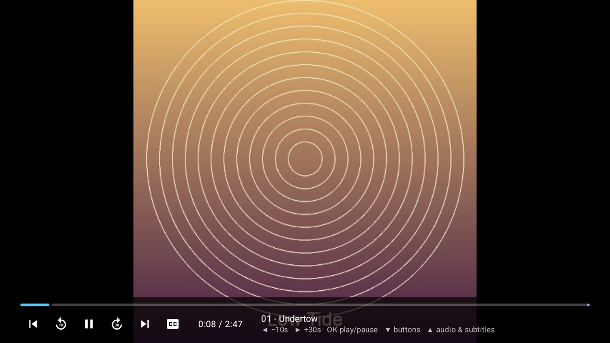 |
| Album folders show tags and duration | Music plays with the cover full-screen |
| 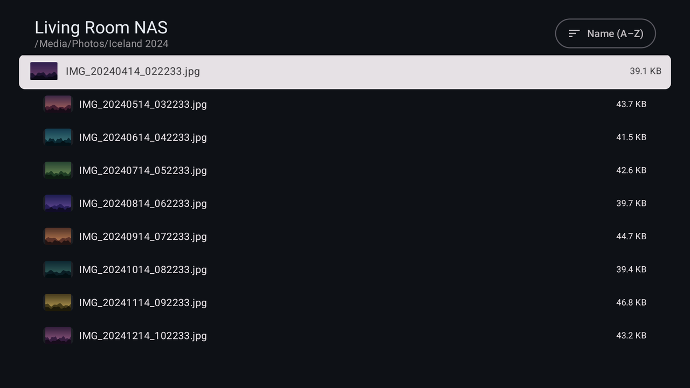 | 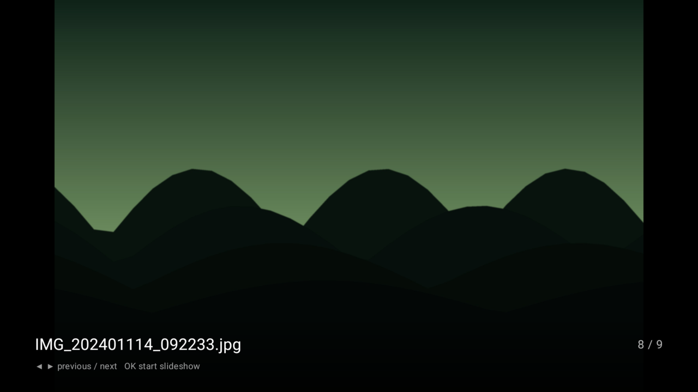 |
| Photo folders show previews | Photos open in the built-in viewer |
| 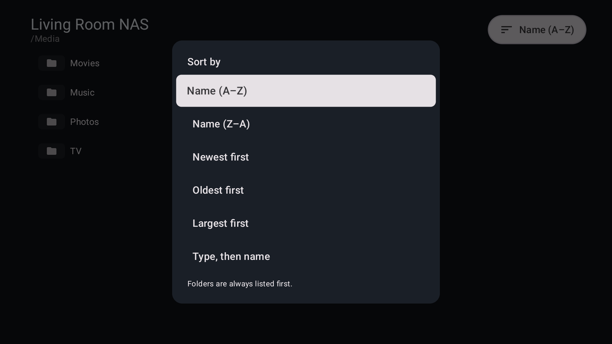 | 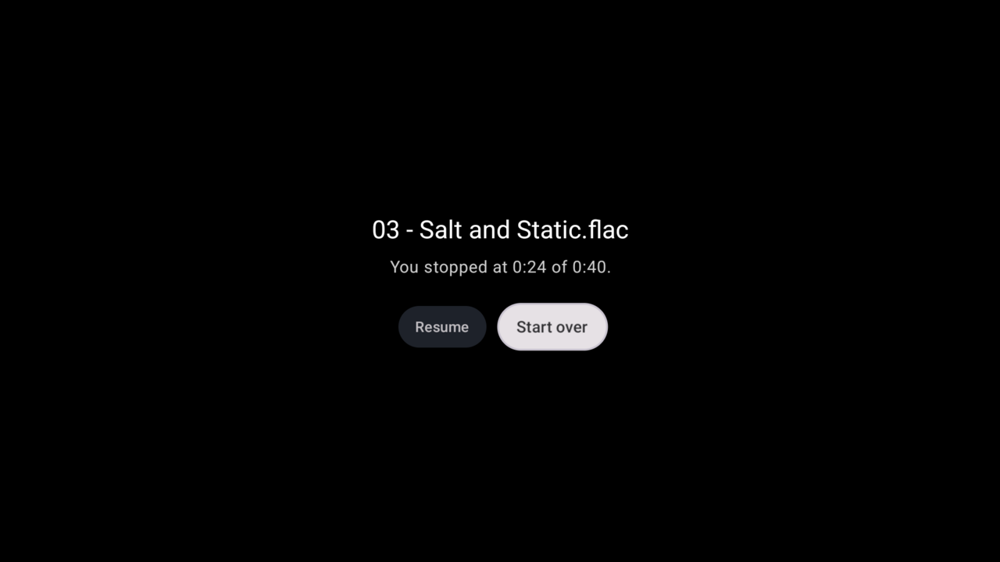 |
| Sort any folder | Pick up where you left off |
| 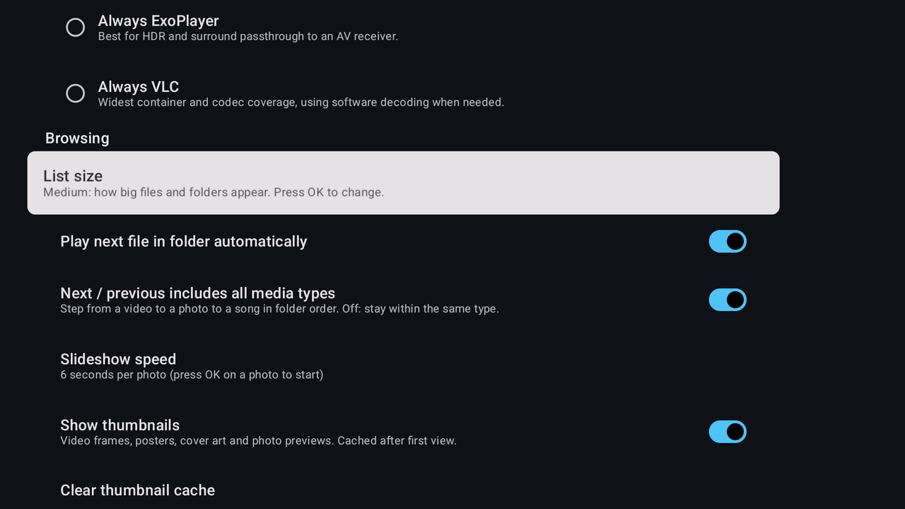 | 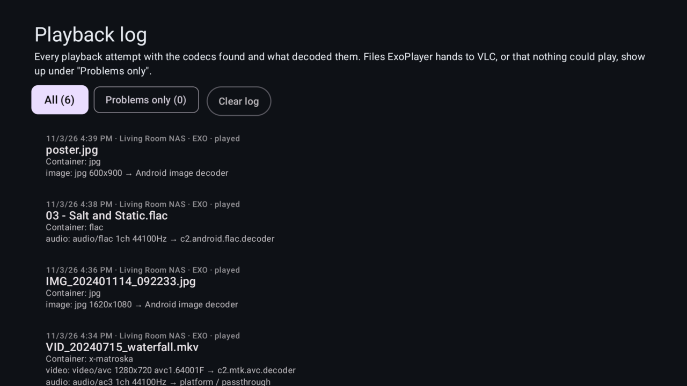 |
| Settings | Playback log for diagnosing codec gaps |
| 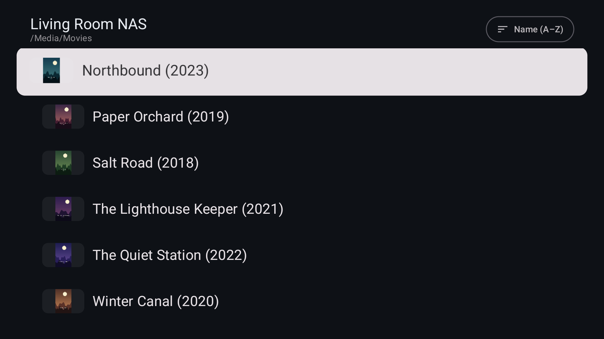 | 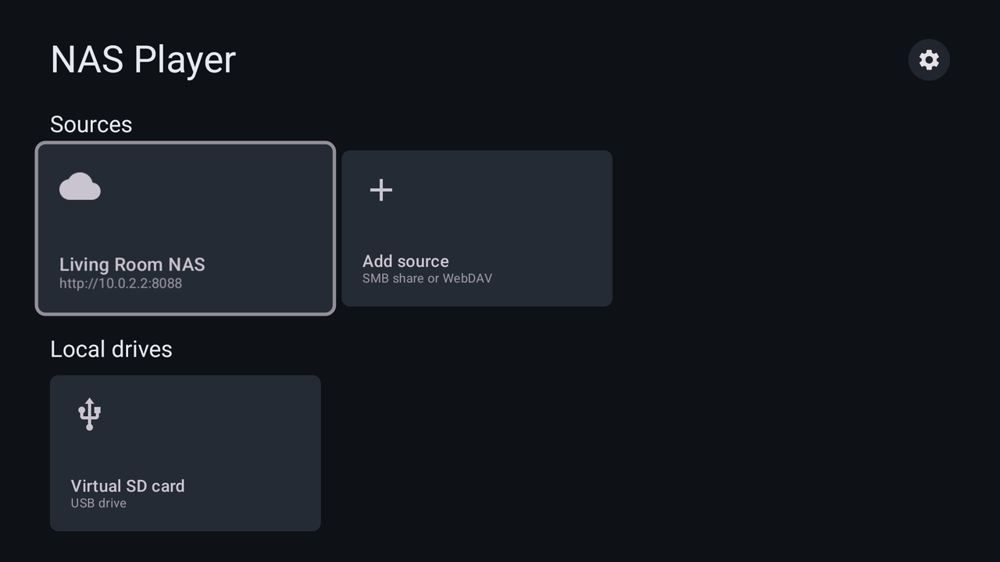 |
| List size set to Extra large | USB drives appear under Local drives |

*Screenshots use a generated demo library (original artwork, test tones and clips). They come from a Google TV Streamer, except the folder lists, sort menu, Settings and USB shots, which come from the Android TV emulator.*

## Features

### Sources
- **SMB 2/3 and WebDAV.** Leave the share blank to choose from all shares on the server, or pin a share or subfolder such as `Media/Movies`.
- SMB servers that advertise over **mDNS/Bonjour** (TrueNAS, Synology, QNAP, macOS, Samba with Avahi) appear under "Found on your network". Select one to add it.
- When adding a source, the form suggests servers it knows about, saved logins for that server, and folders other sources use. **Browse folders** lists the server's folders using the login in the form.
- **Show in Continue watching** can be turned off per source. Your place in its files is still remembered.
- **Test connection** before saving. Hold OK on a source to edit or remove it.
- **USB drives** appear under "Local drives" while plugged in. The first time you open one, Android asks for access to music, photos and videos. The app only ever sees media files and folders (plus subtitles) on the drive, and only reads them.

### Browsing
- **Thumbnails** for every row, generated once and cached on the device:
  - video files: a frame from about 10% in, or sibling art such as `Movie-poster.jpg` / `Movie.jpg`;
  - movie and show folders: `poster.jpg`, `folder.jpg`, `cover.jpg` and the other names Plex, Kodi and Jellyfin use;
  - music: embedded album art, otherwise the folder's cover;
  - photos and photo folders: a preview of the image.
- **Audio tags** in album folders (audio with no video and at most one image): track number, title, artist, album, year and duration from the file's tags. Tested with MP3 over WebDAV so far.
- Artwork files are hidden from listings and from the play queue.
- **List size** in Settings: Small, Medium, Large or Extra large, which scales a folder's rows, text and thumbnails.
- **Sorting** per folder: name A–Z / Z–A (natural order, so episode 2 comes before episode 10), newest, oldest, largest, or by type. Folders always come first, and the choice is remembered.

### Playback
- **Everything plays in-app.** Video, music, photos and the VLC engine all open in the app's own player, and Back returns to the folder you came from.
- **Next / previous follows the folder** across media types: from a video to a photo to a song, in the folder's sort order. Turn this off in Settings to stay within one type.
- **Two video/audio engines, chosen per file:**
  - **ExoPlayer (Media3)** first: hardware video decoding, HDR, and surround passthrough to an AV receiver. The [Jellyfin FFmpeg extension](https://github.com/jellyfin/jellyfin-androidx-media) decodes DTS, TrueHD, AC-3/E-AC-3, MP2 and other audio in software when the TV can't.
  - **libVLC** for containers ExoPlayer can't open (WMV/ASF, RealMedia, APE, ...). It also takes over **automatically** when ExoPlayer can't parse a file, can't decode a track, or finds no video track (DivX 3, ProRes, VC-1, ...).
  - Force either engine for one file from its long-press menu, or for everything in Settings.
- **Photo viewer** for JPEG, PNG, WebP, GIF (animated), BMP, HEIC/HEIF and AVIF (the last two need Android support on the device), with a slideshow at 3, 6, 10 or 20 seconds per photo.
- Resume position per file, a **Continue watching** row, and watched markers. Mark a file watched or unwatched from its long-press menu.
- Sidecar subtitles (`Movie.srt`, `Movie.en.srt`, `.ass`, `.ssa`, `.vtt`) next to the video are picked up automatically.

### Playback log
Settings → Playback log records every attempt: the container, each track's codec, which decoder handled it (hardware codec name, FFmpeg, platform / passthrough, libVLC), every ExoPlayer→VLC handoff or failure with the reason, and any buffering stalls. **Problems only** groups missing codec support by how often it comes up, so you can see what needs adding. The log stores server display names and file paths only, never hosts or credentials.

## Remote controls

| Where | Button | Action |
|---|---|---|
| Lists | OK | Open folder / play |
| | Hold OK | File menu (engine choice, start over, watched) or edit source |
| Video & music | ◀ / ▶ | Back 10 s / forward 30 s, with or without the bar showing |
| | OK | Play / pause |
| | ▼ | Move onto the bar's buttons (previous, back, play, forward, next, tracks); ◀ ▶ choose, OK selects, ▲ or Back leaves |
| | Menu / Captions | Audio and subtitle tracks (also the bar's CC button) |
| Photos | ◀ / ▶ | Previous / next item in the folder |
| | OK | Start / stop slideshow |
| | ▼ | Show filename and position |
| Anywhere in the player | ⏭ / ⏮ media keys | Next / previous item |

## Tested formats

On a Google TV Streamer (Android 14):

| File | Engine | Video | Audio |
|---|---|---|---|
| H.264 + AC-3 5.1 MKV | ExoPlayer | hardware | platform / passthrough |
| H.264 + DTS MKV | ExoPlayer | hardware | FFmpeg |
| HEVC + TrueHD MKV | ExoPlayer | hardware | FFmpeg |
| MPEG-2 + MP2 TS (broadcast) | ExoPlayer | hardware | FFmpeg |
| FLAC with embedded cover | ExoPlayer | — | platform |
| WMV8 + WMA2 | VLC (direct) | libVLC | libVLC |
| DivX 3 AVI | ExoPlayer → VLC fallback | libVLC | libVLC |
| ProRes MOV | ExoPlayer → VLC fallback | libVLC | libVLC |
| JPEG | Photo viewer | Android image decoder | — |

**Throughput:** the release build reads over SMB at 92 Mbit/s on the Streamer's built-in Ethernet, which negotiates at 100 Mbit/s and tops out around 94 Mbit/s of raw TCP. Files averaging above roughly 80 Mbit/s (some UHD remuxes) need a USB-3 gigabit adapter. Debug builds are about three times slower, so judge streaming with a release build.

## Devices

- **Google TV Streamer** and **Chromecast with Google TV** both run a 32-bit (`armeabi-v7a`) userspace, so install the `armeabi-v7a` APK on them.
- Most other current TVs and boxes (Shield, recent Sony/TCL sets): `arm64-v8a`.
- Emulator: `x86_64`, or `arm64-v8a` on Apple Silicon.
- Each build also produces a universal APK.

Requires Android 8.0 (API 26) or newer.

## Building

You need JDK 21 and the Android SDK (platform 37, build-tools 36).

```bash
./gradlew assembleRelease      # APKs in app/build/outputs/apk/release/
./gradlew assembleDebug        # APKs in app/build/outputs/apk/debug/
```

Release builds are signed with the debug key for side-loading; they are not minified, because smbj relies on reflection. Each computer generates its own debug key, and Android only accepts an update signed with the same key as the installed app. Installing from a different computer fails with `INSTALL_FAILED_UPDATE_INCOMPATIBLE`, so build on the original computer or re-sign the APK with its key. Uninstalling first also works, but erases saved sources and resume positions.

### Installing over the network

Enable developer options and network debugging on the TV, then:

```bash
adb connect <tv-ip>:5555                       # accept the prompt on the TV
adb install -r app/build/outputs/apk/release/app-armeabi-v7a-release.apk
```

To read the playback log as JSON lines from a **debug** build:

```bash
adb shell run-as dev.atv.nasplayer cat files/playback-log.jsonl
```

More on the code layout and device testing: [docs/ARCHITECTURE.md](docs/ARCHITECTURE.md) and [docs/TESTING.md](docs/TESTING.md).

## NAS setup tips

- **Use SMB.** With signing and encryption off it streams at link speed; reads are pipelined with SMB 3. NFS has no good Android client library, and WebDAV is slower and makes seeking harder for VLC.
- **WebDAV:** enter the full base URL (e.g. `http://nas.local:8080/media`). Self-signed HTTPS can be allowed per source.
- **Artwork:** put `poster.jpg` (or `folder.jpg` / `cover.jpg`) in movie, show and album folders, the same layout Plex, Kodi and Jellyfin use, and it becomes the thumbnail.
- **Credentials** are kept in app-private storage (backups disabled) and encrypted with the Android Keystore. Some TV firmware has a keystore service that hangs; if it doesn't answer within two seconds the password is stored unencrypted in that same private storage and encrypted on a later save once the keystore responds. If a saved password can't be decrypted, it's left in place rather than overwritten, so it isn't lost.

## License

GPL-3.0-or-later. See [LICENSE](LICENSE).

Bundled components: AndroidX Media3 / ExoPlayer (Apache-2.0), Jellyfin media3-ffmpeg-decoder (GPL-3.0; FFmpeg built with GPL components), libVLC (LGPL-2.1+), smbj and smbj-rpc (Apache-2.0), Coil (Apache-2.0), Bouncy Castle (MIT), OkHttp (Apache-2.0). The banner uses the Inter typeface (SIL OFL 1.1).
